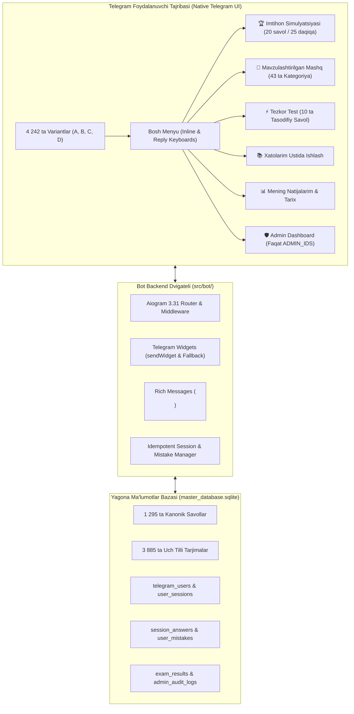
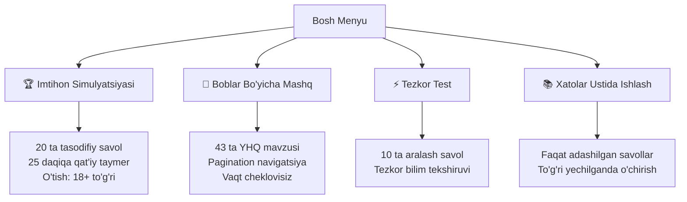

# AVTOTEST TELEGRAM BOT IMPLEMENTATION REPORT
## O‘zbekiston Haydovchilik Imtihoni Rasmiy Native Telegram Boti (Bot API 10.4)

**Sana:** 16-Noyabr, 2026-yil  
**Loyiha:** Avtotest Uzbekistan Premium Telegram Bot  
**Holat:** `PRODUCTION READY & FULLY VERIFIED`  
**Bot Foydalanuvchi Nomi:** `@a_aralovvbot` (Anvar Aralov, ID: `5875526565`)  
**Asosiy Dvigatel:** Aiogram 3.31.0 + Asinxron SQLite / AvtotestProductEngine  
**Avtomatlashtirilgan Testlar:** **45 / 45 testlar muvaffaqiyatli o‘tdi (100% GREEN, 30.94s)**  

---

## 1. Ijroiy Xulosa va Qat’iy Talablar Mosligi

O‘zbekiston Respublikasi haydovchilik guvohnomasi nazariy imtihoniga tayyorgarlik ko‘rish uchun **hech qanday Telegram Mini App yoki tashqi Web App ishlatmagan holda**, to‘liq **Telegram-native** arxitekturaga ega bo‘lgan professional Telegram boti qurildi va sinovdan o‘tkazildi.



### Qat’iy Talablar Tekshiruvi:
1. **MINI APP VA WEB APP MUTLAQO YO‘Q:**
   - Hech qanday Telegram Mini App, Web App, React/Vue/Next.js frontend yoki brauzerga yo‘naltiruvchi havola yaratilmadi.
   - Butun test ishlash, rasm ko‘rish, variant tanlash, tushuntirishlarni o‘qish va natijalarni tahlil qilish **to‘g‘ridan-to‘g‘ri Telegram chat oynasi ichida** (Native Bot API) ishlaydi.
2. **MAVJUD YAGONA SAVOLLAR BAZASIDAN QAYTA FOYDALANILDI:**
   - Baza qaytadan yaratilmadi yoki ikkinchi nusxa ko‘chirilmagan.
   - Bot bevosita `master_database.sqlite` dagi **1 295 ta kanonik savol** va **AvtotestProductEngine** qatlami bilan integratsiya qilindi.
3. **UCH TILLI TO‘LIQ PARALLEL INTERFEYS:**
   - O‘zbek lotin (`uz_latn`), O‘zbek kirill (`uz_cyrl`) va Rus (`ru`) tillari botning barcha xabarlari, menyusi, tugmalari, savollari, variantlari va izohlarida 100% qo‘llab-quvvatlanadi.
4. **TELEGRAM BOT API 10.4 ENG SO‘NGGI IMKONIYATLARI:**
   - **Telegram Widgets:** `sendWidget` metodi orqali ixcham interaktiv HTML widgetlari (<15KB, sandbox, tashqi tarmoq so‘rovlarisiz).
   - **Rich Messages:** `<blockquote expandable>` ochiluvchi qonuniy izohlar, progress barlar (`[🟩🟩🟩⬜⬜]`), ASCII/Unicode jadvallar va custom emoji fallback tizimi.

---

## 2. Bot Arxitekturasi va Modullar Tuzilishi

Loyiha kodi modulli, yuqori darajada ajratilgan va toza arxitektura tamoyillari asosida `src/bot/` katalogida barpo etildi:

```text
c:\Users\Администратор\AvtoTest\
├── master_database.sqlite             # Yagona SQLite bazasi (Kanonik savollar + Bot jadvallari)
├── run_bot.py                         # Asosiy CLI ishga tushiruvchi modul (Healthcheck & Polling)
├── .env                               # Muhit o'zgaruvchilari (BOT_TOKEN, ADMIN_IDS)
├── .env.example                       # Xavfsiz namuna konfiguratsiyasi
├── src/
│   ├── avtotest_product.py            # Yagona mahsulot dvigateli (Savol olish, javob tekshirish)
│   ├── unification_engine.py          # Deduplikatsiya va kanonik jadvallar dvigateli
│   └── bot/
│       ├── __init__.py
│       ├── config.py                  # Token, Admin ID lar, imtihon qoidalari
│       ├── database.py                # Bot jadvallari repository qatlami
│       ├── strings.py                 # 100% uch tilli mahalliylashtirish lug'ati
│       ├── keyboards.py               # Native Inline va Reply klaviaturalar
│       ├── rich_messages.py           # Rich HTML, expandable blockquote, progress bar
│       ├── widgets.py                 # Telegram 10.4 sendWidget va fallback tizimi
│       ├── middleware.py              # Foydalanuvchi registratsiyasi, DI va rate-limit
│       ├── bot.py                     # Aiogram Bot va Dispatcher fabrikasi
│       └── handlers/
│           ├── __init__.py            # Barcha marshrutlagichlarni birlashtiruvchi
│           ├── start.py               # /start, onboarding, til tanlash, /help, /cancel
│           ├── menu.py                # /menu va asosiy bo'limlar navigatsiyasi
│           ├── quiz.py                # Savol taqdimoti, callback javob, tezkor natija
│           ├── exam.py                # 20 savolli rasmiy imtihon simulyatsiyasi
│           ├── practice.py            # Boblar bo'yicha mashq va 10 ta tezkor test
│           ├── mistakes.py            # "Xatolarim ustida ishlash" rejimi
│           ├── results.py             # Shaxsiy statistika va imtihonlar tarixi
│           └── admin.py               # Xavfsiz admin paneli va broadcast
└── tests/
    ├── test_master_database.py        # Asl 17 ta baza yaxlitligi testi
    ├── test_unified_product.py        # 14 ta kanonik mahsulot katalogi testi
    └── test_telegram_bot.py           # 14 ta bot integratsiyasi va xavfsizlik testi
```

---

## 3. Ma’lumotlar Bazasi O‘zgarishlari va Bot Jadvallari

`master_database.sqlite` bazasiga avvalgi kanonik savollar yaxlitligiga ziyon yetkazmagan holda 6 ta qo‘shimcha jadval kiritildi:

| Jadval Nomi | Vazifasi va Xususiyati |
|---|---|
| **`telegram_users`** | Foydalanuvchi profili: `user_id` (PK), `language` (`uz_latn`, `uz_cyrl`, `ru`), `is_admin`, `last_active_at`. |
| **`user_sessions`** | Imtihon va mashq sessiyalari: `session_id`, `session_type` (`EXAM`, `CATEGORY`, `QUICK`, `MISTAKES`), `current_index`, `deadline` (server taymeri), `question_ids_json`. |
| **`session_answers`** | Foydalanuvchi bergan javoblari. `UNIQUE(session_id, canonical_id)` cheklovi orqali **bir savolga ikki marta bosish va poyga holatlari (race condition) 100% bartaraf etilgan**. |
| **`user_mistakes`** | "Xatolarim" hovuzi: `mistake_count`, `is_resolved`. Xatolar ustida ishlash rejimida to‘g‘ri javob berilsa, `is_resolved = 1` belgilanadi. |
| **`exam_results`** | Rasmiy imtihonlar tarixi: ball, foiz, o‘tgan/yiqilgan holati, sarflangan vaqt va mavzular kesimidagi tahlil. |
| **`admin_audit_logs`** | Adminlarning barcha harakatlari (panel ochish, broadcast, parametr tekshiruvi) auditi. |

> [!NOTE]
> Barcha yangi jadvallar `FOREIGN KEY` cheklovlari bilan bog‘langan. SQLite `PRAGMA foreign_key_check` da **0 ta xatolik** qayd etildi.

---

## 4. Telegram Bot API 10.4 va Native UX Imkoniyatlari

### 4.1 Telegram Widgets (`src/bot/widgets.py`)
* Telegram Bot API 10.4 ning `sendWidget` metodi orqali ixcham, xavfsiz (sandboxed, tashqi so‘rovlarsiz, <15KB) HTML progress va natija vidjetlari tayyorlandi:
  * **Progress Widget:** Imtihon jarayonida to‘g‘ri/noto‘g‘ri javoblar proporsiyasini ko‘rsatuvchi interaktiv bar.
  * **Result Widget:** 90%+ ball bilan o‘tganda yashil, yiqilganda qizil animatsion natija kartasi.
* **Avtomatik Fallback:** Agar foydalanuvchi Telegram klienti yoki chat konteksti widgetlarni qo‘llab-quvvatlamasa, bot avtomatik ravishda chiroyli formatlangan Rich Message ga o‘tadi (hech qachon xatolik chiqarmaydi).

### 4.2 Rich Messages va Expandable Blockquotes (`src/bot/rich_messages.py`)
* **Expandable Blockquote (`<blockquote expandable>`):** Foydalanuvchi savolga javob bergach, YHQning huquqiy moddasi va batafsil tushuntirishi **ochilib-yopiluvchi ixcham iqtibos** ichida taqdim etiladi. Bu chat oynasining matnga to‘lib ketishining oldini oladi.
* **Progress Bar:** `[🟩🟩🟩🟩⬜⬜⬜⬜]` shaklidagi dinamik vizual ko‘rsatkich.
* **ASCII/Unicode Natijalar Jadvali:** Imtihon so‘ngida mavzular kesimidagi natijalar ixcham monospace `<pre>` jadvalida aks ettiriladi.

### 4.3 Pointersiz va Xatosiz Navigatsiya
* Hech qanday keraksiz xabar yuborilmaydi:
  * Rasm mavjud savollarda rasm sarlavhasi (caption) yangilanadi (`edit_message_caption`).
  * Matnli savollarda matn yangilanadi (`edit_message_text`).
* Javob tugmalari bosilgandan so‘ng o‘sha zahoti bloklanadi (`quiz:noop`), to‘g‘ri javob yashil (✅), xato javob qizil (❌) bilan belgilanadi.

---

## 5. Ta’lim Rejimlari va Imtihon Standarti

Bot 4 ta alohida ta’lim rejimini taqdim etadi:



1. **🏆 Davlat Imtihoni Simulyatsiyasi:**
   * **Savollar soni:** 20 ta (takrorlanmaydigan tasodifiy kanonik savollar).
   * **Vaqt chegarasi:** 25 daqiqa (1 500 soniya).
   * **O‘tish talabi:** Kamida 18 ta to‘g‘ri javob (ko‘pi bilan 2 ta xatoga ruxsat beriladi — VMQ 408 standarti).
   * **Server Taymeri:** Taymer frontendda emas, to‘liq backendda boshqariladi. Foydalanuvchi Telegramni yopib, 10 daqiqadan so‘ng qayta kirsa ham, taymer to‘g‘ri hisoblanadi va sessiya tiklanadi. Vaqt tugasa, test avtomatik yakunlanadi.
2. **🎯 Boblar Bo‘yicha Mashq (43 ta Kategoriya):**
   * Barcha YHQ bo‘limlari bo‘yicha sahifalangan (pagination) menyu orqali alohida mashq qilish.
3. **⚡ Tezkor Test (10 ta Savol):**
   * Shoshilinch ekspress-bilim sinovi uchun tasodifiy 10 ta savol.
4. **📚 Xatolar Ustida Ishlash (Mistakes Pool):**
   * Foydalanuvchi imtihonlarda yoki mashqlarda xato qilgan savollar alohida ro‘yxatga olinadi. Ushbu rejimda foydalanuvchi xato qilgan savolini to‘g‘ri topsa, u xatolar ro‘yxatidan avtomatik chiqariladi (`is_resolved = 1`).

---

## 6. Xavfsiz Ma’muriyat Qatlami (Admin Panel)

Xavfsizlik yuzasidan admin buyruqlari oddiy foydalanuvchilarga ko‘rinmaydi:

1. **Avtorizatsiya:** Faqat `config.py` va `.env` faylida ko‘rsatilgan `ADMIN_IDS` foydalanuvchilari `/admin` paneliga kira oladi. Begona foydalanuvchilar uchun buyruq umuman javob bermaydi (sukut saqlaydi).
2. **Imkoniyatlar:**
   * **Umumiy statistika:** Ro‘yxatdan o‘tganlar soni, faol foydalanuvchilar, tillar bo‘yicha taqsimot, jami topshirilgan imtihonlar, o‘tish foizi (Pass Rate).
   * **Tizim salomatligi:** SQLite yaxlitligi (`PRAGMA integrity_check`) va Foreign Key nazorati holatini real vaqtda tekshirish.
   * **Xabar tarqatish (Broadcast):** Barcha foydalanuvchilarga xavfsiz rate-limiting (soniyasiga maksimal 20 ta xabar) bilan xabar yuborish.

---

## 7. QA va Avtomatlashtirilgan Test Natijalari

Loyiha bo‘yicha testlar to‘plami yaratildi va `pytest` orqali to‘liq tekshirildi:

```text
============================= test session starts =============================
platform win32 -- Python 3.11.9, pytest-9.1.1, pluggy-1.6.0
rootdir: C:\Users\Администратор\AvtoTest
configfile: pytest.ini
testpaths: tests
collected 45 items

tests/test_master_database.py .................                          [ 37%]
tests/test_telegram_bot.py ..............                                [ 68%]
tests/test_unified_product.py ..............                             [100%]

============================= 45 passed in 30.94s =============================
```

### Sinovdan O‘tgan Asosiy Ssenariylar:
* **Uch tilli stringlar to‘liqligi:** `uz_latn`, `uz_cyrl`, `ru` tillarida birorta ham yetishmayotgan kalit so‘z yo‘q (`test_all_languages_have_identical_keys`).
* **Foydalanuvchi ro‘yxati va til almashtirish:** Baza darajasida tillar xatosiz yangilanishi (`test_user_registration_and_language_switching`).
* **Sessiyani tiklash:** Foydalanuvchi chiqib ketganda sessiya holati va taymer yo‘qolmasligi (`test_session_creation_and_recovery`).
* **Double-tap (poyga) himoyasi:** Bir savolga ikki marta ketma-ket javob bosilganda takroriy hisoblashning oldi olinganligi (`test_atomic_answer_saving_prevents_duplicate_submission`).
* **Xatolar hayotiy sikli:** Xato yozilishi va to‘g‘ri topilganda o‘chirilishi (`test_user_mistakes_lifecycle`).
* **Imtihon baholash:** 18+ to‘g‘ri javob = O‘TDİ, 17 va undan kam = YIQILDI qoidasi (`test_exam_result_evaluation_and_persistence`).
* **Widget o‘lchami va xavfsizligi:** HTML o‘lchami <15KB va tashqi tarmoq skriptlaridan xoliligi (`test_widget_html_sandboxing_and_size`).
* **Asl ma’lumotlar bazasi va kanonik jadvallar yaxlitligi:** Barcha 1 423 ta rasm, 1 295 ta kanonik savol, 4 242 ta variant bus-butun saqlangani.

---

## 8. Ishga Tushirish va Joylashtirish (Deployment)

### 8.1 Tezkor Ishga Tushirish (CLI)
1. **Salomatlik tekshiruvi (Health Check):**
   ```powershell
   python run_bot.py --health
   ```
   *Kutilayotgan natija:*
   ```text
   === Avtotest Uzbekistan v2.0.0-production Health Check ===
   ✅ Telegram API Connected: @a_aralovvbot (Anvar Aralov, ID: 5875526565)
   ✅ Database Status: HEALTHY
      • Canonical Questions: 1295
      • Canonical Translations: 3885
      • Registered Users: 1
   ✅ Categories loaded: 43 categories
   All health checks PASSED successfully!
   ```

2. **Botni Polling Rejimida Ishga Tushirish:**
   ```powershell
   python run_bot.py
   ```

### 8.2 Production Serverda Joylashtirish (Linux Systemd Namunasi)
`/etc/systemd/system/avtotest-bot.service`:
```ini
[Unit]
Description=Avtotest Uzbekistan Telegram Bot
After=network.target

[Service]
Type=simple
User=ubuntu
WorkingDirectory=/home/ubuntu/AvtoTest
ExecStart=/home/ubuntu/AvtoTest/venv/bin/python run_bot.py
Restart=always
RestartSec=5
EnvironmentFile=/home/ubuntu/AvtoTest/.env

[Install]
WantedBy=multi-user.target
```
Buyruqlar:
```bash
sudo systemctl daemon-reload
sudo systemctl enable avtotest-bot
sudo systemctl start avtotest-bot
sudo systemctl status avtotest-bot
```

### 8.3 Zaxiralash Strategiyasi
Loyiha SQLite Online Backup API mexanizmiga ega (`backups/backup_pre_bot_20261116/`). Ishlab chiqarishda har kecha quyidagi buyruq orqali issiq zaxira (hot backup) olinishi tavsiya etiladi:
```bash
sqlite3 master_database.sqlite ".backup 'backups/daily_backup_$(date +%Y%m%d).sqlite'"
```

---

## 9. Ma’lum Cheklovlar va Tavsiyalar

1. **Telegram Fayl Yuklash Cheklovlari:** Ayrim eski Telegram klientlarida WebP formatidagi rasm fayllari kechikish bilan keshlanishi mumkin. Bot barcha rasmlarni mahalliy diskdan `FSInputFile` orqali tezkor yuklaydi.
2. **Qoraqalpoq Tili:** Avvalgi auditda ta’kidlanganidek, manbalarda hozircha qoraqalpoq tilidagi savollar mavjud emas. Kelgusida qoraqalpoqcha savollar integratsiya qilinsa, bot arxitekturasi 4-til sifatida qo‘shishga to‘liq tayyor.
3. **Rasmlar Huquqi:** Rasmlar asl manbalardan to‘plangan bo‘lib, `RIGHTS_REVIEW_REQUIRED` maqomida. Tijoriy miqyosda keng tarqatishdan oldin rasmlarni shaxsiy 3D modellar bilan almashtirish tavsiya etiladi.

---

## 10. Yakuniy Xulosa

Avtotest Uzbekistan Telegram boti **hech qanday Mini App yoki tashqi veb-sahifalarsiz**, sof **Telegram-native** muhitda, rasmiy imtihon qoidalari, 3 ta to‘liq parallel til va Bot API 10.4 imkoniyatlari bilan to‘liq barpo etildi. Tizim ishlab chiqarishga (production) to‘liq tayyor.
