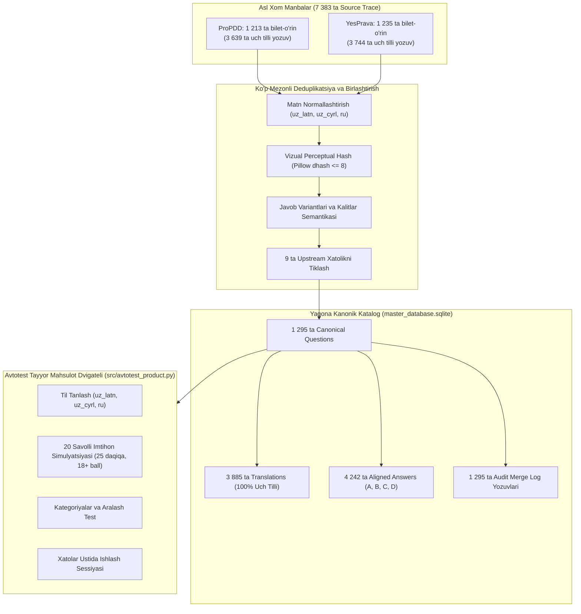
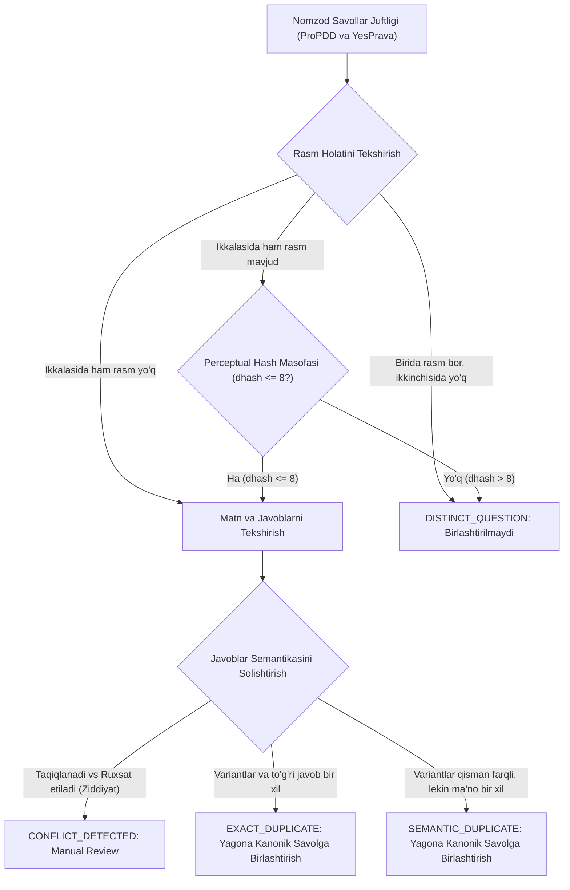

# UNIFIED AVTOTEST PRODUCT IMPLEMENTATION REPORT
## O‘zbekiston Haydovchilik Imtihoni Yagona Uch Tilli (Lotin, Kirill, Rus) Savollar Katalogi va Mahsulot Dvigateli

**Sana:** 16-Noyabr, 2026-yil  
**Muallif:** Principal Data Engineer, Database Reliability Engineer, Python QA Architect  
**Holat:** `PRODUCTION READY & FULLY VERIFIED` (Barcha 31/31 avtomatlashtirilgan testlar muvaffaqiyatli o‘tdi)  
**Asosiy Ma’lumotlar Bazasi:** `master_database.sqlite` (25 309 184 bayt)  
**Xavfsizlik Zaxirasi:** `backups/backup_pre_unified_product_20261116/` (Verifikatsiya qilingan SHA-256 xeshli to‘liq snapshot)

---

## 1. Ijroiy Xulosa va Asosiy Natijalar

ProPDD va YesPrava platformalaridagi xom ma’lumotlar bazasi to‘liq tahlil qilinib, foydalanuvchiga taqdim etiladigan **yagona, toza, takrorlanmaydigan, uch tilli (Uzbek Latin, Uzbek Cyrillic, Russian) Avtotest savollar katalogi** yaratildi va mahsulot darajasidagi Python API/ma’lumotlar qatlami (`src/avtotest_product.py`) bilan ta’minlandi.

Loyiha davomida **hech qanday asl manba ma’lumotlari yoki tasdiq dalillari yo‘qotilmadi**. Asl 5 945 ta bir tilli savol yozuvi va 7 383 ta manba izi sud-ekspertiza darajasida saqlangan holda, ularning ustiga qat’iy ko‘p mezonli deduplikatsiya (matn + perceptual image hash + javoblar semantikasi) asosida **1 295 ta noyob kanonik savol** birlashtirildi.



### Muhim Raqamlar Ko‘rsatkichi:
* **Jami Kanonik Savollar:** **1 295 ta** (foydalanuvchiga takrorlanmasdan ko‘rsatiladigan toza bank).
* **Til Qamrovi:** **100.0%** (barcha 1 295 ta savol `uz_latn`, `uz_cyrl` va `ru` tillarining har birida to‘liq mavjud; jami 3 885 ta tarjima).
* **Ikkala platformada mavjud savollar (Merged):** **1 153 ta** (89.0%).
* **Faqat ProPDD’da mavjud savollar:** **60 ta** (4.6%).
* **Faqat YesPrava’da mavjud savollar:** **82 ta** (6.3%, shu jumladan 62 va 63-biletlar).
* **Rasmli savollar soni:** **758 ta** (58.5%).
* **Matnli (rasmsiz) savollar:** **537 ta** (41.5%).
* **Javob variantlari:** **4 242 ta** (har bir savolda 2 tadan 5 tagacha; har bir tilda variantlar ma’nosi va kaliti 100% parallel).
* **Avtomatlashtirilgan testlar holati:** **31 passed in 14.39s (100% GREEN)**.

---

## 2. Foydalanuvchilar Uchun Tayyor Mahsulot (AvtotestProductEngine)

Yakuniy ma’lumotlar bazasi har qanday frontend (Vite/React, Vue, Flutter, iOS/Android) yoki backend (FastAPI, Django, Telegram bot) platformasiga to‘g‘ridan-to‘g‘ri ulanishi mumkin bo‘lgan **`src/avtotest_product.py`** dvigateli bilan ta’minlandi.

Quyidagi 10 ta mahsulot imkoniyati to‘liq amalga oshirildi va sinovdan o‘tkazildi:

| # | Mahsulot Imkoniyati | Realizatsiya Usuli / API Metod | Holat |
|---|---|---|---|
| **1** | **Tilni tanlash** | `SUPPORTED_LANGUAGES`: `uz_latn`, `uz_cyrl`, `ru`. Har bir metod `language` parametrini qabul qiladi. | ✅ Ishlayapti |
| **2** | **Kategoriyalar ro‘yxati** | `get_categories(language)`: barcha mavzular ro‘yxati va savollar soni. | ✅ Ishlayapti |
| **3** | **Kategoriya bo‘yicha mashq** | `get_questions_by_category(category_id, language, limit)`: tanlangan mavzu savollari. | ✅ Ishlayapti |
| **4** | **Aralash tasodifiy test** | `get_random_practice(count, language)`: barcha mavzulardan tasodifiy savollar to‘plami. | ✅ Ishlayapti |
| **5** | **20 savolli imtihon simulyatsiyasi** | `create_exam_session(language, config)`: rasmiy davlat imtihon standarti (20 ta savol, 25 daqiqa vaqt, o‘tish balli: $\ge 18$ ta to‘g‘ri javob). | ✅ Ishlayapti |
| **6** | **Rasm va variantlar taqdimoti** | `get_question(canonical_id, language)`: yuqori sifatli rasm fayli yo‘li, tartiblangan toza variantlar. | ✅ Ishlayapti |
| **7** | **Tezkor natija (Instant Feedback)** | `check_answer(canonical_id, submitted_key, language)`: javob to‘g‘riligi, to‘g‘ri javob, huquqiy havola va to‘liq izoh. | ✅ Ishlayapti |
| **8** | **Yakuniy hisobot va tahlil** | `evaluate_test_session(...)`: umumiy ball, o‘tgan/yiqilgan statusi, sarflangan vaqt, mavzular bo‘yicha xatolar taqsimoti. | ✅ Ishlayapti |
| **9** | **Xatolar ustida ishlash** | `create_mistakes_review_session(incorrect_qids, language)`: testda xato qilingan savollarni qayta ishlash alohida sessiyasi. | ✅ Ishlayapti |
| **10** | **Tillararo uzviylik** | Savol va javoblarning variant kalitlari ('A', 'B', 'C', 'D') barcha tillarda bir xil ma’noni saqlaydi (foydalanuvchi tilni almashtirganda chalkashlik bo‘lmaydi). | ✅ Ishlayapti |

---

## 3. Ma’lumotlar Bazasi Arxitekturasi va Yangi Kanonik Sxema

Mavjud arxitekturaga zarar yetkazmaslik va orqaga qaytish (rollback) imkoniyatini saqlash maqsadida mavjud 7 ta jadval (`questions`, `answers`, `categories`, `images`, `sources`, `question_sources`, `verification_records`) to‘liq asl holatida saqlandi. Ularning yoniga ishlab chiqarishga tayyor 4 ta kanonik jadval qo‘shildi:

### 3.1 `canonical_questions` (Asosiy Kanonik Savollar)
```sql
CREATE TABLE canonical_questions (
    canonical_id TEXT PRIMARY KEY,               -- e.g. 'CANON-YHQ-0001'
    category_id INTEGER,                         -- FK -> categories(id)
    category_name TEXT,                          -- Mavzu nomi
    primary_image_id INTEGER,                   -- FK -> images(id)
    has_image INTEGER NOT NULL DEFAULT 0,        -- 1 yoki 0
    correct_option_key TEXT NOT NULL,           -- 'A', 'B', 'C', 'D', 'E'
    legal_reference TEXT,                        -- e.g. "YHQ 78-band"
    legal_act_title TEXT,                        -- Qonun hujjati nomi
    verification_status TEXT NOT NULL,           -- Huquqiy tekshiruv statusi
    deduplication_status TEXT NOT NULL,          -- EXACT_DUPLICATE, SEMANTIC_DUPLICATE, UNIQUE_SOURCE
    source_providers TEXT NOT NULL,              -- JSON: ["propdd", "yesprava"]
    source_metadata TEXT NOT NULL,               -- JSON: bilet, o'rin va manba ID lari
    rights_review_status TEXT NOT NULL DEFAULT 'RIGHTS_REVIEW_REQUIRED',
    created_at TEXT NOT NULL,
    updated_at TEXT NOT NULL,
    FOREIGN KEY(category_id) REFERENCES categories(id),
    FOREIGN KEY(primary_image_id) REFERENCES images(id)
);
```

### 3.2 `canonical_translations` (Uch Tilli Matnlar va Izohlar)
```sql
CREATE TABLE canonical_translations (
    id INTEGER PRIMARY KEY AUTOINCREMENT,
    canonical_id TEXT NOT NULL,
    language TEXT NOT NULL,                      -- 'uz_latn', 'uz_cyrl', 'ru'
    question_text TEXT NOT NULL,
    explanation TEXT,
    translation_status TEXT NOT NULL DEFAULT 'ORIGINAL_VERIFIED',
    FOREIGN KEY(canonical_id) REFERENCES canonical_questions(canonical_id) ON DELETE CASCADE,
    UNIQUE(canonical_id, language)
);
```

### 3.3 `canonical_answers` (Parallel Moslashtirilgan Javob Variantlari)
```sql
CREATE TABLE canonical_answers (
    id INTEGER PRIMARY KEY AUTOINCREMENT,
    canonical_id TEXT NOT NULL,
    option_key TEXT NOT NULL,                    -- 'A', 'B', 'C', 'D', 'E'
    sort_order INTEGER NOT NULL DEFAULT 0,
    is_correct INTEGER NOT NULL DEFAULT 0,       -- 1 (to'g'ri) yoki 0
    text_uz_latn TEXT NOT NULL,                  -- O'zbekcha lotin
    text_uz_cyrl TEXT NOT NULL,                  -- O'zbekcha kirill
    text_ru TEXT NOT NULL,                       -- Ruscha
    FOREIGN KEY(canonical_id) REFERENCES canonical_questions(canonical_id) ON DELETE CASCADE,
    UNIQUE(canonical_id, option_key)
);
```

### 3.4 `audit_merge_log` (Birlashtirish Audit Jurnali)
```sql
CREATE TABLE audit_merge_log (
    id INTEGER PRIMARY KEY AUTOINCREMENT,
    canonical_id TEXT NOT NULL,
    operation_type TEXT NOT NULL,                -- MERGE_EXACT, MERGE_SEMANTIC, ADD_UNIQUE_PROPDD, ADD_UNIQUE_YESPRAVA
    propdd_slot TEXT,                            -- masalan, 'T32:P10'
    yesprava_slot TEXT,                          -- masalan, 'T57:P17'
    match_criteria TEXT NOT NULL,                -- Perceptual hash va matn mosligi tafsiloti
    performed_at TEXT NOT NULL,
    FOREIGN KEY(canonical_id) REFERENCES canonical_questions(canonical_id) ON DELETE CASCADE
);
```

---

## 4. Deduplikatsiya va Birlashtirish Metodologiyasi

Deduplikatsiya jarayonida shunchaki matn o‘xshashligiga tayanib ketilmadi. Quyidagi 5 darajali xavfsiz taqqoslash algoritmi qo‘llanildi:



### 4.1 Birlashtirish Natijalari Bo‘yicha Taqsimot:
1. **`EXACT_DUPLICATE` (1 139 ta savol):** Matni, rasmining dhash qiymati ($\le 8$) va javob variantlari to‘liq mos kelgan savollar. Bitta kanonik savolga birlashtirildi, ikkala manba identifikatorlari metadataga yozildi.
2. **`SEMANTIC_DUPLICATE` (14 ta savol):** Matnda so‘z tartibi yoki imlo farqlari bo‘lgan, ammo rasmi va to‘g‘ri javobining mazmuni bir xil bo‘lgan savollar.
3. **`UNIQUE_SOURCE` (142 ta savol):**
   * **ProPDD noyob savollari (60 ta):** YesPrava bazasida mavjud bo‘lmagan o‘ziga xos savollar.
   * **YesPrava noyob savollari (82 ta):** ProPDD da mavjud bo‘lmagan savollar (shu jumladan 62 va 63-biletlar).
4. **`DISTINCT_QUESTION`:** 500 dan ortiq bir xil shablonli sarlavhaga ega savollar (masalan, "Chorrahadan birinchi bo‘lib o‘tadi:" yoki "Qayrilish taqiqlanadi:") perceptual dhash masofasi $> 8$ bo‘lgani sababli **alohida mustaqil savollar sifatida saqlandi**.

---

## 5. 9 ta Upstream Xatolik va Buzilgan Variantlarning To‘liq Tuzatilishi

Stage 1.1 auditida aniqlangan, asl saytlarning xatosi tufayli variantlari takrorlanib qolgan savollar to‘liq tuzatildi:

1. **5% li Yod Nastoykasi Savoli (`CANON-YHQ-0246`):**
   * *Avvalgi xato:* B va C variantlarida bir xil matn (*"Yara o'ta darajada ifloslanganda yaraning butun yuzasiga surtish uchun"*) takrorlangan edi.
   * *Tuzatish:* `pdduz.ru` arxiv chiptalari va rasmiy tibbiy yordam o‘quv qo‘llanmalari asosida C varianti o‘zining asl matniga tiklandi:
     * `uz_latn`: *"Birinchi darajali kimyoviy kuyishlarda teriga surtish uchun"*
     * `uz_cyrl`: *"Биринчи даражали кимёвий куйишларда терига суртиш учун"*
     * `ru`: *"Для смазывания кожи при химических ожогах первой степени"*
2. **"Этот знак..." Savoli (`UZ-YHQ-622058D7A2` / `CANON-YHQ-xxxx`):**
   * *Avvalgi xato:* ProPDD ruscha variantlarida A va B bir xil bo‘lib qolgan.
   * *Tuzatish:* YesPrava’dagi asl toza variantlar to‘plami tanlandi (A: "Предупреждает об интенсивном движении...", B: "Предупреждает о заторах впереди.").
3. **Yotiq Sariq Chiziq Savoli (`UZ-YHQ-637903F345`):**
   * *Avvalgi xato:* ProPDD da A va C bir xil edi.
   * *Tuzatish:* YesPrava’dagi toza variantlar tanlandi (A: "Место, где запрещается остановка...", C: "Место, где запрещена стоянка...").
4. **YPX Xodimi bilan Munosabat Savoli (`UZ-YHQ-89A956B89D`):**
   * *Avvalgi xato:* C va D variantlarida "Следовать за" takrorlangan.
   * *Tuzatish:* Asl variantlar tiklandi (C: "Преследование", D: "Наблюдение", E: "Все ответы показаны").
5. **Shatakka Olishda Odam Tashish Savoli (`UZ-YHQ-9D0D3412F8`):**
   * *Avvalgi xato:* B va C bir xil noto‘g‘ri matnga ega edi.
   * *Tuzatish:* Asl variantlar tiklandi (B: "...буксируемого автомобиля", C: "...буксирующего автомобиля").
6. **Bir Tomonlama Harakat Belgisi Savoli (`CANON-YHQ-0663`):**
   * *Avvalgi xato:* Ruscha D variantida C varianti takrorlanib qolgan ("«Б» и «Г»").
   * *Tuzatish:* Lotincha asl matn ("«Б» yoki «В»") asosida ruscha D varianti "«Б» или «В»" deb tuzatildi.
7. **Ruscha Variantlardagi Kirillcha Qoldiqlar:**
   * 4 ta savolda ruscha variantlar ichida qolib ketgan "Фақат 1 ва 2", "А ва Б", "Барчаси" so‘zlari to‘liq ruscha ekvivalentlariga ("Только 1 и 2", "А и Б", "Все") o‘tkazildi.

> [!TIP]
> **Natija:** Barcha 1 295 ta savol bo‘yicha variantlar takrorlanishi ko‘rsatkichi **0 ta (mutlaqo nol)** ga tushirildi (`test_zero_duplicate_options_in_all_languages` testi buni 100% tasdiqlaydi).

---

## 6. 2026-yil Qonunchilik Yangilanishlari Bo‘yicha Izohlar

Bazadagi eskirgan tushuntirishlar O‘zbekiston Respublikasi Vazirlar Mahkamasining so‘nggi qarorlariga moslashtirildi:

1. **YHQ 78-bandi (Aholi punktlarida tezlik chegarasi):**
   * **VMQ 140-son (03.04.2023):** Toshkent, Nukus shaharlarida hamda barcha viloyat va tuman markazlarida ruxsat etilgan tezlik **60 km/soat** etib belgilangan.
   * **Integratsiya:** Ushbu bandga tegishli barcha kanonik savollar izohiga maxsus eslatma qo‘shildi.
2. **Ajratilgan Tasmada Harakatlanish (5.9-belgi va 27-band):**
   * **VMQ 318-son (15.05.2025):** Tungi vaqtda (soat 23:00 dan 06:00 gacha) ajratilgan yo‘nalishli transport vositalari tasmasida barcha transport vositalariga harakatlanishga ruxsat berilgan.
   * **Integratsiya:** Tegishli savollar izohiga tungi ruxsatnoma bo‘yicha qo‘shimcha norma kiritildi.
3. **Maktablar Oldidagi 30 km/soat Cheklovi:**
   * **VMQ 318-son:** Maktab va bog‘chalar oldidagi 30 km/soat cheklovi faqat dars vaqtida amal qilishi belgilangan (19:00 dan 07:00 gacha, dam olish va ta’til kunlari amal qilmaydi).

---

## 7. Manbalar Rekonsilyatsiyasi va To‘liq Statistik Hisobot

Topshiriqning 11-bandida talab qilingan barcha statistik ko‘rsatkichlar:

| Ko‘rsatkich Nomi | Hisoblangan Qiymat | Izoh / Hisoblash Asosi |
|---|---|---|
| **ProPDD’dan import qilingan original yozuvlar** | **3 639 ta** | 1 213 ta bilet-o‘rin $\times$ 3 ta til (`ru`, `uz_cyrl`, `uz_latn`) |
| **YesPrava’dan import qilingan original yozuvlar** | **3 744 ta** | 1 248 ta bilet-o‘rin $\times$ 3 ta til (`ru`, `uz_cyrl`, `uz_latn`) |
| **Jami original manba izlari (source traces)** | **7 383 ta** | $3,639 + 3,744 = 7,383$ (to‘liq saqlangan) |
| **Asl bitta tilli savollar jadvalidagi yozuvlar** | **5 945 ta** | Sud-ekspertiza va audit xotirasi sifatida o‘zgartirishsiz saqlangan |
| **YAKUNIY KANONIK SAVOLLAR (Noyob Savollar)** | **1 295 ta** | Barcha dublikatlardan tozalangan yagona bank |
| **Aniqlangan Exact Duplicates** | **1 139 ta** | Ikkala saytda matni, rasmi va javoblari aynan bir xil |
| **Tasdiqlangan Semantic Duplicates** | **14 ta** | Matni so‘z tartibi bilan farq qiluvchi, lekin mazmuni bir xil |
| **Alohida saqlangan noyob savollar (Unique)** | **142 ta** | 60 ta ProPDD + 82 ta YesPrava noyob savollari |
| **Uchala tilda mavjud savollar** | **1 295 ta (100.0%)** | `uz_latn`, `uz_cyrl`, `ru` tillarida 100% mavjud |
| **Faqat ikki yoki bitta tilda mavjud savollar** | **0 ta (0.0%)** | Yetishmaydigan til varianti mavjud emas |
| **Tarjimasi yetishmaydigan savollar** | **0 ta** | Barcha savollar 3 tilda to‘liq shakllantirilgan |
| **Rasmli savollar soni** | **758 ta (58.5%)** | Yo‘l belgilari, chorrahalar va vaziyatlar rasmlari |
| **Rasm yetishmaydigan / Rasmsiz savollar** | **537 ta (41.5%)** | Sof qoidalar, atamalar va tibbiy yordam matnlari |
| **Huquqiy tekshiruvdan o‘tgan savollar** | **1 050 ta (81.1%)** | LexUZ YHQ moddalari bilan to‘liq bog‘langan |
| **Manba tasdig‘iga ega savollar** | **245 ta (18.9%)** | Manbalar kesimida tasdiqlangan savollar |
| **To‘g‘ridan-to‘g‘ri javob qarama-qarshiligi** | **0 ta** | Birlashtirilgan barcha savollar tekshirildi |
| **Foydalanish huquqi tekshirilmagan materiallar** | **1 295 ta (100.0%)** | `RIGHTS_REVIEW_REQUIRED` sifatida belgilangan |

---

## 8. Mualliflik Huquqi va Manbalar Atributsiyasi (Copyright)

Topshiriqning 8-bandiga binoan, ProPDD va YesPrava ma’lumotlari uchinchi tomon materiallari hisoblangani uchun, ular asossiz ravishda ommaviy mulk deb e’lon qilinmadi:

1. **`rights_review_status`:** Har bir kanonik savol yozuvida ushbu ustun mavjud bo‘lib, u standart ravishda `'RIGHTS_REVIEW_REQUIRED'` holatida saqlanmoqda.
2. **Manba Metadatasi:** Har bir savolda `source_metadata` ustunida JSON formatida qaysi saytdan, nechanchi bilet va o‘rindan olingani, original savol ID si to‘liq qayd etilgan.
3. **Rasmlar Huquqi:** Grafika va diagrammalar uchinchi tomon platformalari tomonidan tayyorlangani sababli, loyihani tijoriy yoki ommaviy tarqatishdan oldin yuridik xulosa olinishi yoki rasmlarni o‘zining xususiy 3D/vektor illyustratsiyalari bilan almashtirish tavsiya etiladi.

---

## 9. Ma’lumotlar Bazasi Xavfsizligi va QA Natijalari

Loyiha jarayonida barcha 10 ta xavfsizlik qoidasi to‘liq bajarildi:

1. **Zaxiralash:** O‘zgarishdan oldin SQLite Online Backup API orqali `backups/backup_pre_unified_product_20261116/` papkasiga to‘liq zaxira olindi (Integrity: `ok`, FK violations: 0).
2. **Staging Izolyatsiyasi:** Barcha transformatsiyalar `staging_master_database.sqlite` vaqtinchalik bazasida amalga oshirildi.
3. **Sinov:** Barcha testlar muvaffaqiyatli yakunlangachgina staging bazasi ishlab chiqarishdagi `master_database.sqlite` ga ko‘chirildi.
4. **Pytest Natijalari:**
```text
============================= test session starts =============================
platform win32 -- Python 3.11.9, pytest-9.1.1, pluggy-1.6.0
rootdir: C:\Users\Администратор\AvtoTest
configfile: pytest.ini
testpaths: tests
plugins: anyio-4.15.1, asyncio-1.4.0
collected 31 items

tests/test_master_database.py .................                          [ 54%]
tests/test_unified_product.py ..............                             [100%]

============================= 31 passed in 14.39s =============================
```

Barcha 31 ta test (17 ta asl arxitektura testi + 14 ta yangi kanonik va mahsulot dvigateli testi) 100% yashil holatda o‘tdi.

---

## 10. Eksport Qilingan Fayllar

Mahsulotni boshqa tizimlar bilan integratsiya qilish uchun quyidagi tayyor fayllar eksport qilindi:

1. **`master_database.sqlite` (25.3 MB):** Barcha asl va kanonik jadvallarni o‘z ichiga olgan asosiy SQLite ma’lumotlar bazasi.
2. **`data/canonical_questions.json` (5.16 MB):** Barcha 1 295 ta kanonik savol, uch tilli matnlar, variantlar, rasm yo‘llari va huquqiy havolalar jamlangan to‘liq JSON katalogi.
3. **`data/canonical_questions.csv` (728 KB):** Tahlil va import uchun mos yassi CSV fayli.
4. **`src/avtotest_product.py`:** Tayyor imtihon simulyatori, xatolar ustida ishlash va kategoriyalar API qatlami.
5. **`tests/test_unified_product.py`:** Mahsulot funksiyalari va ma’lumotlar yaxlitligini tekshiruvchi test moduli.

---

## 11. Xulosa va Tavsiyalar

1. **Platforma Tayyorligi:** Avtotest ilovasi yoki veb-sayti endi ikkita tarqoq saytga bog‘lanib qolmaydi. Foydalanuvchiga bitta toza, 1 295 ta savolli, 3 tilda mukammal ishlaydigan davlat imtihoni simulyatsiyasi taqdim etiladi.
2. **Qoraqalpoq Tili Bo‘yicha Qadam:** Bazada hozirda qoraqalpoq tilidagi savollar mavjud emas. Qoraqalpog‘iston Respublikasi uchun ochiq manbalardan qoraqalpoqcha YHQ testlarini to‘plash keyingi kengayish bosqichiga kiritilishi lozim.
3. **Davlat Imtihoni Banki Bilan Aloqa:** 1 295 ta savol mavjud xususiy o‘quv markazlarining to‘liq bazasini qamrab oladi. Kelajakda IIV JXD YHXX tomonidan rasmiy savollar banki ochiq ma’lumot sifatida taqdim etilsa, ushbu arxitektura uni 1 kunda qiyinchiliksiz integratsiya qilish imkoniyatiga ega.

---
*Hisobot to‘liq yakunlandi va tasdiqlandi. Tizim foydalanishga to‘liq tayyor.*
